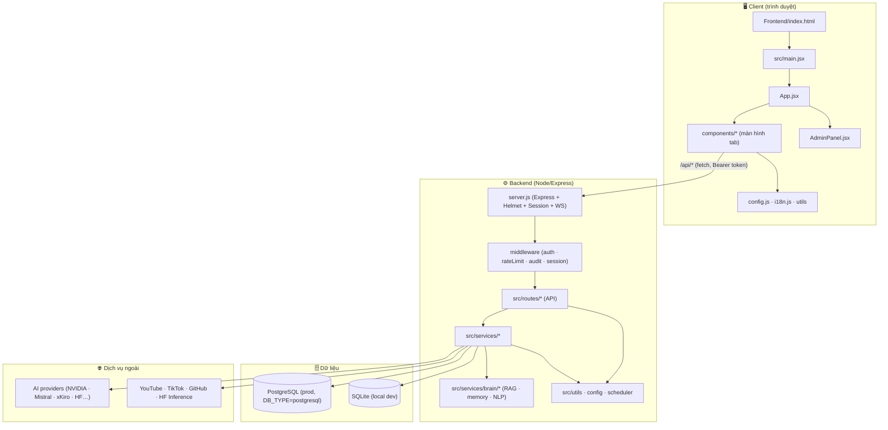

# REXI-AI — Bản đồ kiến trúc

> **TỰ SINH** bởi `tools/dev/gen_map.mjs` từ quét repo thật — **KHÔNG sửa tay** (sẽ bị ghi đè).
> Cập nhật: `node tools/dev/gen_map.mjs` (từ project root). Bản đồ tương tác 2D/3D: [`docs/map.html`](docs/map.html).
> Sinh lúc: `2026-11-09 12:03:14`

**Thống kê:** 128 file/module · 213 API request · 33 bảng DB · 589 liên kết · 25 service · 29 UI component.

## 1. Sơ đồ tầng (luồng dữ liệu)

## 2. Mount API (server.js → routes), & luồng request

| Mount | Route file | Endpoints |
|---|---|---|
| `/api/admin/import-sqlite` | `express` | 0 |
| `/api/auth` | `Backend/src/routes/auth.routes.js` | 12 |
| `/api/chat` | `Backend/src/routes/chat.routes.js` | 29 |
| `/api/services` | `Backend/src/routes/services.routes.js` | 82 |
| `/api/scrape` | `Backend/src/routes/scrape.routes.js` | 15 |
| `/api/models` | `Backend/src/routes/models.routes.js` | 19 |
| `/api/media` | `Backend/src/routes/media.routes.js` | 2 |
| `/api/workspace` | `Backend/src/routes/workspace.routes.js` | 3 |
| `/api/agent` | `Backend/src/routes/agent.routes.js` | 7 |
| `/api/social` | `Backend/src/routes/social.routes.js` | 4 |
| `/api/admin` | `Backend/src/routes/admin.routes.js` | 19 |
| `/api/admin/github` | `Backend/src/routes/github.routes.js` | 20 |
| `/api/services` | `(server) realtimeTranscriptionRoutes` | 0 |

Request đi từ **ui/flib → /api/… → middleware → route → service → DB/AI**. Mọi call `apiFetch()` ở frontend tự gắn `Authorization: Bearer <token>` (xem `Frontend/src/config.js`).

## Entry / khởi động (4)

| File | Dòng | Hàm≈ | KB | Endpoints | Import nội bộ |
|---|---:|---:|---:|---:|---|
| `Backend/server.js` | 414 | 5 | 21.5 | 9 | 28 |
| `Frontend/index.html` | 133 | 0 | 7.3 |  |  |
| `Frontend/src/main.jsx` | 162 | 3 | 6.9 |  | 4 |
| `Backend/video-worker.js` | 52 | 1 | 2.1 |  | 1 |

## Frontend UI (29)

| File | Dòng | Hàm≈ | KB | Endpoints | Import nội bộ |
|---|---:|---:|---:|---:|---|
| `Frontend/src/App.jsx` | 2606 | 58 | 127.2 |  | 24 |
| `Frontend/src/AdminPanel.jsx` | 1985 | 43 | 116.1 |  | 4 |
| `Frontend/src/components/YouTubeTab.jsx` | 1172 | 31 | 61.5 |  | 2 |
| `Frontend/src/components/VideoCreatorTab.jsx` | 1003 | 15 | 59.7 |  | 1 |
| `Frontend/src/components/ScrapePanel.jsx` | 1089 | 19 | 56.7 |  | 2 |
| `Frontend/src/components/GitHubTrending.jsx` | 1093 | 17 | 51.7 |  | 3 |
| `Frontend/src/components/StudioTab.jsx` | 807 | 19 | 42.0 |  | 2 |
| `Frontend/src/components/TikTokFeedTab.jsx` | 693 | 12 | 34.1 |  | 2 |
| `Frontend/src/components/ChatTab.jsx` | 500 | 5 | 31.7 |  | 2 |
| `Frontend/src/components/IPTVTab.jsx` | 611 | 8 | 29.7 |  | 3 |
| `Frontend/src/components/BrowserView.jsx` | 413 | 10 | 16.4 |  | 3 |
| `Frontend/src/components/OpenShortsTab.jsx` | 343 | 8 | 16.3 |  | 3 |
| `Frontend/src/components/Sidebar.jsx` | 293 | 5 | 13.8 |  | 3 |
| `Frontend/src/components/SettingsModal.jsx` | 267 | 4 | 13.5 |  | 3 |
| `Frontend/src/components/ImageGenTab.jsx` | 245 | 5 | 13.1 |  | 2 |
| `Frontend/src/components/HelpModal.jsx` | 226 | 0 | 12.8 |  | 1 |
| `Frontend/src/components/VideoEditTab.jsx` | 186 | 4 | 12.5 |  | 2 |
| `Frontend/src/components/VideoToolsModal.jsx` | 177 | 3 | 8.6 |  | 2 |
| `Frontend/src/components/OpenCutTab.jsx` | 171 | 5 | 7.9 |  | 3 |
| `Frontend/src/components/WebAnalyzer.jsx` | 146 | 2 | 7.7 |  | 3 |
| `Frontend/src/components/SocialConnect.jsx` | 174 | 3 | 7.5 |  | 2 |
| `Frontend/src/components/DocumentsTab.jsx` | 163 | 4 | 7.5 |  | 2 |
| `Frontend/src/components/SuperToolsModal.jsx` | 75 | 0 | 4.9 |  | 2 |
| `Frontend/src/components/GameTab.jsx` | 93 | 3 | 4.2 |  | 3 |
| `Frontend/src/components/ClassroomTab.jsx` | 83 | 0 | 3.6 |  | 2 |
| `Frontend/src/components/CodeEditorTab.jsx` | 56 | 0 | 2.6 |  | 2 |
| `Frontend/src/components/SkillsModal.jsx` | 34 | 0 | 2.1 |  | 2 |
| `Frontend/src/components/DesktopTab.jsx` | 37 | 0 | 1.8 |  | 2 |
| `Frontend/src/components/GameFrame.jsx` | 45 | 0 | 1.8 |  | 2 |

## Frontend lib & utils (6)

| File | Dòng | Hàm≈ | KB | Endpoints | Import nội bộ |
|---|---:|---:|---:|---:|---|
| `Frontend/src/i18n.js` | 1664 | 3 | 93.4 |  |  |
| `Frontend/src/i18n-sweep.js` | 232 | 2 | 14.2 |  | 1 |
| `Frontend/src/data/iptvCountries.js` | 253 | 0 | 10.4 |  |  |
| `Frontend/src/config.js` | 163 | 3 | 7.0 |  |  |
| `Frontend/src/utils/sanitize.js` | 134 | 7 | 5.7 |  |  |
| `Frontend/src/strip-vi.js` | 26 | 1 | 1.6 |  |  |

## Backend routes (12)

| File | Dòng | Hàm≈ | KB | Endpoints | Import nội bộ |
|---|---:|---:|---:|---:|---|
| `Backend/src/routes/services.routes.js` | 4269 | 141 | 207.0 | 82 | 20 |
| `Backend/src/routes/chat.routes.js` | 2140 | 55 | 115.1 | 29 | 23 |
| `Backend/src/routes/models.routes.js` | 1000 | 27 | 52.8 | 19 | 5 |
| `Backend/src/routes/admin.routes.js` | 669 | 37 | 34.9 | 19 | 3 |
| `Backend/src/routes/github.routes.js` | 694 | 30 | 28.4 | 20 | 5 |
| `Backend/src/routes/auth.routes.js` | 593 | 20 | 26.9 | 12 | 3 |
| `Backend/src/routes/scrape.routes.js` | 252 | 18 | 9.9 | 15 | 4 |
| `Backend/src/routes/media.routes.js` | 125 | 8 | 7.1 | 2 | 4 |
| `Backend/src/routes/agent.routes.js` | 136 | 9 | 5.5 | 7 | 4 |
| `Backend/src/routes/workspace.routes.js` | 137 | 7 | 4.8 | 3 | 1 |
| `Backend/src/routes/social.routes.js` | 137 | 8 | 4.8 | 4 | 2 |
| `Backend/src/routes/realtimeTranscription.routes.js` | 137 | 6 | 3.9 | 1 | 2 |

## Middleware (7)

| File | Dòng | Hàm≈ | KB | Endpoints | Import nội bộ |
|---|---:|---:|---:|---:|---|
| `Backend/src/middleware/auth.middleware.js` | 128 | 6 | 5.6 |  | 1 |
| `Backend/src/middleware/sqliteSessionStore.js` | 88 | 0 | 3.5 |  | 1 |
| `Backend/src/middleware/kiloQuota.js` | 66 | 4 | 2.9 |  |  |
| `Backend/src/middleware/promptNormalizer.middleware.js` | 72 | 2 | 2.4 |  |  |
| `Backend/src/middleware/rateLimit.middleware.js` | 64 | 1 | 2.3 |  | 1 |
| `Backend/src/middleware/audit.middleware.js` | 59 | 1 | 1.9 |  | 2 |
| `Backend/src/middleware/rateLimit.js` | 34 | 1 | 1.1 |  |  |

## Backend services (25)

| File | Dòng | Hàm≈ | KB | Endpoints | Import nội bộ |
|---|---:|---:|---:|---:|---|
| `Backend/src/services/scraper.js` | 1480 | 75 | 64.5 |  | 3 |
| `Backend/src/services/ytdlpService.js` | 862 | 39 | 41.3 |  |  |
| `Backend/src/services/agentService.js` | 608 | 17 | 31.7 |  | 11 |
| `Backend/src/services/tiktokService.js` | 633 | 29 | 28.9 |  | 2 |
| `Backend/src/services/modelRouter.js` | 529 | 24 | 22.8 |  | 3 |
| `Backend/src/services/browserStream.js` | 547 | 2 | 22.6 |  | 4 |
| `Backend/src/services/videoEdit.js` | 350 | 23 | 18.1 |  | 2 |
| `Backend/src/services/agentEngine.js` | 383 | 18 | 17.2 |  | 2 |
| `Backend/src/services/ragService.js` | 400 | 12 | 15.3 |  | 2 |
| `Backend/src/services/social.js` | 371 | 13 | 14.8 |  | 2 |
| `Backend/src/services/videoRenderer.js` | 294 | 9 | 12.3 |  |  |
| `Backend/src/services/chatExecutor.js` | 275 | 14 | 12.1 |  | 2 |
| `Backend/src/services/realtimeTranscription.js` | 408 | 1 | 10.8 |  |  |
| `Backend/src/services/internalAgent.js` | 192 | 9 | 10.3 |  | 4 |
| `Backend/src/services/edgeTTS.js` | 232 | 10 | 9.5 |  |  |
| `Backend/src/services/quotaManager.js` | 185 | 12 | 7.7 |  | 1 |
| `Backend/src/services/skillRouter.js` | 133 | 3 | 6.7 |  |  |
| `Backend/src/services/codeRunner.js` | 133 | 5 | 6.2 |  |  |
| `Backend/src/services/healthCheck.js` | 106 | 4 | 5.2 |  | 2 |
| `Backend/src/services/intentRouter.js` | 113 | 2 | 4.8 |  |  |
| `Backend/src/services/telemetry.js` | 96 | 7 | 3.3 |  |  |
| `Backend/src/services/reminderScheduler.js` | 74 | 4 | 3.3 |  | 1 |
| `Backend/src/services/nvidiaChat.js` | 86 | 5 | 3.2 |  |  |
| `Backend/src/services/autoResearch.js` | 64 | 2 | 2.9 |  | 1 |
| `Backend/src/services/opencutBridge.js` | 64 | 4 | 2.3 |  |  |

## Brain (AI/memory/NLP) (9)

| File | Dòng | Hàm≈ | KB | Endpoints | Import nội bộ |
|---|---:|---:|---:|---:|---|
| `Backend/src/services/brain/nlp/entity-extractor.js` | 384 | 6 | 16.7 |  |  |
| `Backend/src/services/brain/memory/memory-service.js` | 311 | 14 | 14.7 |  | 5 |
| `Backend/src/services/brain/context/context.js` | 231 | 12 | 9.2 |  | 3 |
| `Backend/src/services/brain/nlp/tokenizer-utils.js` | 158 | 7 | 6.2 |  |  |
| `Backend/src/services/brain/profile/profile-service.js` | 152 | 9 | 6.1 |  | 1 |
| `Backend/src/services/brain/intelligence/intelligence.js` | 151 | 2 | 6.0 |  | 5 |
| `Backend/src/services/brain/memory/embedding-service.js` | 158 | 6 | 5.6 |  | 2 |
| `Backend/src/services/brain/nlp/sentiment-intent.js` | 159 | 2 | 5.2 |  | 1 |
| `Backend/src/services/brain/memory/memory-similarity.js` | 62 | 5 | 1.9 |  | 1 |

## Backend utils/config/scheduler (33)

| File | Dòng | Hàm≈ | KB | Endpoints | Import nội bộ |
|---|---:|---:|---:|---:|---|
| `Backend/src/utils/jsQR.js` | 10102 | 46 | 250.9 |  |  |
| `Backend/src/model-scanner.scheduler.js` | 1133 | 38 | 62.4 |  | 2 |
| `tools/ytdlp-worker/worker.js` | 651 | 23 | 31.4 |  |  |
| `Backend/src/github-trending-scheduler.js` | 570 | 30 | 21.6 |  | 2 |
| `Backend/tests/brain/brain.test.js` | 345 | 7 | 19.1 |  | 9 |
| `tools/dev/gen_map.mjs` | 365 | 11 | 16.7 |  |  |
| `Backend/src/init-db.js` | 218 | 9 | 15.8 |  | 1 |
| `Backend/src/config/db.js` | 359 | 5 | 15.5 |  |  |
| `Backend/scripts/scan_iptv.js` | 304 | 7 | 12.9 |  |  |
| `Backend/scripts/scan_full.js` | 220 | 12 | 11.1 |  | 1 |
| `Backend/src/utils/urlSafety.js` | 208 | 10 | 9.6 |  |  |
| `Backend/src/ensure-admin.js` | 177 | 2 | 9.1 |  | 1 |
| `Backend/src/sync/syncWorker.js` | 181 | 10 | 8.1 |  | 1 |
| `Backend/scripts/code-guardian.js` | 192 | 5 | 8.0 |  |  |
| `Backend/scripts/seed_skills.js` | 116 | 1 | 7.0 |  |  |
| `Backend/nchat/app.js` | 190 | 8 | 6.9 |  |  |
| `Backend/scripts/seed_sqlserver_skills.js` | 87 | 1 | 6.4 |  |  |
| `Backend/src/utils/safeExec.js` | 162 | 5 | 5.8 |  |  |
| `Backend/src/utils/qr.js` | 121 | 2 | 5.7 |  | 1 |
| `Backend/scripts/scan_countries.js` | 142 | 5 | 5.7 |  |  |
| `Backend/scripts/validate-vietnamese.js` | 145 | 2 | 5.5 |  |  |
| `Backend/src/utils/pii.js` | 149 | 4 | 4.6 |  |  |
| `Backend/tests/router/router.advanced.test.js` | 82 | 1 | 4.4 |  | 4 |
| `Backend/tests/router/router.test.js` | 78 | 1 | 4.1 |  | 2 |
| `Backend/src/scheduler.js` | 79 | 4 | 2.9 |  | 1 |
| `Backend/src/utils/cryptoKeys.js` | 67 | 3 | 2.9 |  |  |
| `Backend/src/utils/stripAnsi.js` | 72 | 1 | 2.4 |  |  |
| `Backend/scripts/rebuild-sqlite3-linux.js` | 33 | 0 | 1.5 |  |  |
| `Backend/src/utils/readOnlySqlite.js` | 40 | 1 | 1.3 |  |  |
| `Backend/decrypt_tokens.js` | 37 | 1 | 1.3 |  |  |
| `Backend/scripts/create_admin.js` | 24 | 0 | 0.9 |  | 1 |
| `Backend/scripts/reset_admin.js` | 29 | 0 | 0.9 |  | 1 |
| `Backend/src/utils/activityLog.js` | 21 | 1 | 0.8 |  | 1 |

## Deploy / runtime (3)

| File | Dòng | Hàm≈ | KB | Endpoints | Import nội bộ |
|---|---:|---:|---:|---:|---|
| `render.yaml` | 66 | 0 | 2.8 |  |  |
| `vercel.json` | 36 | 0 | 0.6 |  |  |
| `package.json` | 11 | 0 | 0.3 |  |  |

## 3. API Request (method + path) theo router (213)

### `/api/auth` — `Backend/src/routes/auth.routes.js`

- `POST /api/auth/register`
- `POST /api/auth/login`
- `POST /api/auth/logout`
- `POST /api/auth/google`
- `GET /api/auth/google/callback`
- `GET /api/auth/github/callback`
- `POST /api/auth/forgot-password`
- `POST /api/auth/reset-password`
- `GET /api/auth/users`
- `PUT /api/auth/users/:id/role`
- `PUT /api/auth/users/:id/status`
- `GET /api/auth/stats`

### `/api/chat` — `Backend/src/routes/chat.routes.js`

- `GET /api/chat/conversations/all`
- `GET /api/chat/admin/conversations/:userId`
- `GET /api/chat/admin/conversations/trash`
- `GET /api/chat/conversations`
- `GET /api/chat/conversations/search`
- `POST /api/chat/conversations`
- `POST /api/chat/conversations/:id/pin`
- `GET /api/chat/guest-limits`
- `DELETE /api/chat/conversations/:id`
- `POST /api/chat/admin/conversations/:id/reply`
- `DELETE /api/chat/admin/conversations/:id`
- `POST /api/chat/admin/conversations/:id/restore`
- `DELETE /api/chat/admin/conversations/:id/permanent`
- `GET /api/chat/keys`
- `POST /api/chat/keys`
- `POST /api/chat/fetch-models`
- `POST /api/chat/admin/cache/clear-models`
- `GET /api/chat/conversations/:id/messages`
- `POST /api/chat/conversations/:id/messages`
- `POST /api/chat/conversations/:id/messages/stream`
- `GET /api/chat/memory`
- `POST /api/chat/memory`
- `DELETE /api/chat/memory/:id`
- `POST /api/chat/exec`
- `GET /api/chat/git/status`
- `GET /api/chat/git/diff`
- `POST /api/chat/search`
- `POST /api/chat/intent`
- `GET /api/chat/routing-stats`

### `/api/services` — `Backend/src/routes/services.routes.js`

- `GET /api/services/skills`
- `GET /api/services/skills/all`
- `PUT /api/services/skills/:id/toggle`
- `GET /api/services/desktop/screenshot`
- `POST /api/services/desktop/click`
- `GET /api/services/external/weather`
- `GET /api/services/external/stocks/:symbol`
- `GET /api/services/tts/voices`
- `GET /api/services/tts/status`
- `POST /api/services/tts`
- `POST /api/services/tts/clone`
- `POST /api/services/tts/custom-voices`
- `GET /api/services/tts/custom-voices`
- `GET /api/services/tts/custom-voices/:id/sample`
- `DELETE /api/services/tts/custom-voices/:id`
- `POST /api/services/tts/custom-voices/:id/speak`
- `GET /api/services/iptv/proxy`
- `GET /api/services/iptv/channels`
- `GET /api/services/iptv/countries`
- `GET /api/services/youtube/status`
- `GET /api/services/youtube/search`
- `GET /api/services/youtube/stream`
- `GET /api/services/youtube/comments`
- `GET /api/services/youtube/channel-avatar`
- `POST /api/services/youtube/comments/youtube`
- `POST /api/services/youtube/comments/local`
- `GET /api/services/youtube/proxy`
- `POST /api/services/youtube/summarize`
- `GET /api/services/tiktok/feed`
- `GET /api/services/tiktok/stream`
- `GET /api/services/tiktok/media`
- `POST /api/services/tiktok/session`
- `POST /api/services/tiktok/qr/start`
- `GET /api/services/tiktok/qr/status`
- `POST /api/services/tiktok/classify`
- `POST /api/services/office/generate-docx`
- `POST /api/services/office/generate-pptx`
- `POST /api/services/office/process-pdf`
- `POST /api/services/transcribe`
- `POST /api/services/browser/launch`
- `POST /api/services/browser/navigate`
- `POST /api/services/browser/click`
- `POST /api/services/browser/type`
- `POST /api/services/browser/key`
- `POST /api/services/browser/scroll`
- `POST /api/services/browser/close`
- `GET /api/services/browser/status`
- `GET /api/services/browser/stream-sse`
- `GET /api/services/browser/ws-selftest`
- `POST /api/services/browser/act`
- `GET /api/services/video/status`
- `POST /api/services/video/render`
- `POST /api/services/video/preview`
- `POST /api/services/video/save`
- `POST /api/services/generate-video`
- `POST /api/services/generate-image`
- `POST /api/services/documents/upload`
- `GET /api/services/documents`
- `DELETE /api/services/documents/:id`
- `POST /api/services/exec-code`
- `GET /api/services/conversations/:id/export`
- `POST /api/services/qr`
- `POST /api/services/conversations/:id/share`
- `GET /api/services/share/:token`
- `GET /api/services/stats/me`
- `POST /api/services/reminders`
- `GET /api/services/reminders`
- `DELETE /api/services/reminders/:id`
- `GET /api/services/notifications`
- `GET /api/services/admin/logs`
- `POST /api/services/openshorts/process`
- `GET /api/services/openshorts/status/:jobId`
- `GET /api/services/openshorts/quota`
- `POST /api/services/video/edit`
- `GET /api/services/video/file/:name`
- `POST /api/services/opencut-bridge/poll`
- `POST /api/services/opencut-bridge/result`
- `GET /api/services/opencut-bridge/status`
- `POST /api/services/opencut-bridge/shot`
- `POST /api/services/opencut-bridge/ask`
- `POST /api/services/video/upload`
- `USE /api/services/classroom`

### `/api/scrape` — `Backend/src/routes/scrape.routes.js`

- `GET /api/scrape/status`
- `POST /api/scrape/info`
- `POST /api/scrape/page`
- `POST /api/scrape/comments`
- `POST /api/scrape/comments/summary`
- `POST /api/scrape/comments/answer`
- `POST /api/scrape/batch`
- `POST /api/scrape/download`
- `POST /api/scrape/channel`
- `POST /api/scrape/search`
- `POST /api/scrape/findchannel`
- `POST /api/scrape/dig`
- `POST /api/scrape/ingest`
- `POST /api/scrape/ask`
- `POST /api/scrape/pipeline`

### `/api/models` — `Backend/src/routes/models.routes.js`

- `GET /api/models`
- `GET /api/models/test-db-select`
- `GET /api/models/providers`
- `GET /api/models/admin/providers`
- `PUT /api/models/admin/providers/:providerId`
- `GET /api/models/admin/models`
- `POST /api/models/admin/models`
- `DELETE /api/models/admin/models/:modelId`
- `POST /api/models/admin/models/sync`
- `POST /api/models/scan`
- `POST /api/models/admin/models/verify-and-scan`
- `POST /api/models/admin/models/publish-active`
- `POST /api/models/admin/models/scan-all`
- `POST /api/models/admin/models/clear-and-reset`
- `POST /api/models/admin/models/scan-provider`
- `GET /api/models/admin/models/scan-cache`
- `GET /api/models/admin/models/weekly-schedule`
- `POST /api/models/admin/models/weekly-schedule`
- `POST /api/models/admin/models/weekly-schedule/reset`

### `/api/media` — `Backend/src/routes/media.routes.js`

- `POST /api/media/image`
- `POST /api/media/speech`

### `/api/workspace` — `Backend/src/routes/workspace.routes.js`

- `GET /api/workspace/files`
- `GET /api/workspace/file-content`
- `POST /api/workspace/file-content`

### `/api/agent` — `Backend/src/routes/agent.routes.js`

- `POST /api/agent/chat`
- `GET /api/agent/chain`
- `PUT /api/agent/chain`
- `GET /api/agent/tools`
- `POST /api/agent/execute`
- `POST /api/agent/process-file`
- `POST /api/agent/web-analyze`

### `/api/social` — `Backend/src/routes/social.routes.js`

- `GET /api/social/status`
- `GET /api/social/:platform/connect`
- `GET /api/social/:platform/callback`
- `POST /api/social/:platform/post`

### `/api/admin` — `Backend/src/routes/admin.routes.js`

- `GET /api/admin/status`
- `GET /api/admin/stats`
- `GET /api/admin/channels`
- `GET /api/admin/countries`
- `GET /api/admin/scan-history`
- `GET /api/admin/changes`
- `POST /api/admin/channels`
- `PUT /api/admin/channels/:id`
- `DELETE /api/admin/channels/:id`
- `GET /api/admin/channels/export/:format`
- `GET /api/admin/notifications`
- `PUT /api/admin/notifications/read-all`
- `PUT /api/admin/notifications/:id/read`
- `DELETE /api/admin/notifications/:id`
- `POST /api/admin/scan-now`
- `GET /api/admin/logs`
- `POST /api/admin/cleanup`
- `POST /api/admin/import-sqlite`
- `GET /api/admin/export-db`

### `/api/admin/github` — `Backend/src/routes/github.routes.js`

- `GET /api/admin/github/trending`
- `GET /api/admin/github/search`
- `GET /api/admin/github/saved`
- `POST /api/admin/github/saved`
- `DELETE /api/admin/github/saved/:owner/:name`
- `GET /api/admin/github/repo/:owner/:name`
- `GET /api/admin/github/stars/:owner/:name/history`
- `GET /api/admin/github/export/saved`
- `GET /api/admin/github/export/starred`
- `GET /api/admin/github/digest/status`
- `POST /api/admin/github/digest/send`
- `POST /api/admin/github/stars/snapshot`
- `GET /api/admin/github/notifications`
- `GET /api/admin/github/notifications/unread-count`
- `POST /api/admin/github/notifications/read`
- `GET /api/admin/github/starred/:owner/:name`
- `POST /api/admin/github/starred/batch`
- `POST /api/admin/github/star`
- `DELETE /api/admin/github/star/:owner/:name`
- `GET /api/admin/github/starred`

## 4. Bảng dữ liệu DB (33)

`IF` · `_sync_log` · `_sync_queue` · `ai_models` · `ai_providers` · `app_settings` · `audit_log` · `bo_nho_dai_han` · `chia_se_hoi_thoai` · `context_sessions` · `cuoc_hoi_thoai` · `iptv_channels` · `iptv_notifications` · `iptv_scan_log` · `khoa_api` · `ky_nang` · `lich_nhac` · `model_agent_cap` · `model_scan_cache` · `nguoi_dung` · `nhat_ky` · `provider_scan_log` · `provider_throttle` · `repo_summaries` · `saved_repos` · `sessions_store` · `star_snapshots` · `starred_repos` · `thong_bao` · `tiktok_phien` · `tin_nhan` · `trending_cache` · `trending_notifications`

> Schema khai báo ở `Backend/src/init-db.js` (CREATE TABLE IF NOT EXISTS khi khởi động). Prod dùng PostgreSQL (Supabase) qua `DB_TYPE=postgresql`; local dùng SQLite.

## 5. Deploy / runtime

- `render.yaml` — service `rexi-ai-backend` (Render free, oregon, Node 24). Build: `Backend npm i` → `npx playwright install chromium` → `Frontend npm i && npm run build`. Start: `cd Backend && node server.js`.
- Backend phục vụ luôn `Frontend/dist` (SPA). Health check: `GET /api/health`.
- Prod env (Postgres, JWT_SECRET, ADMIN_*, HF_TOKEN…): `docs/PROD-ENV.md`.
- Domain: https://rexiai.bot.cd
